# Annotate-to-chat workflow: changes and screenshots

Screenshots and notes for a set of small changes to [Orca](https://github.com/stablyai/orca),
made in this fork. The code is on the `feat/*` branches; `fork/build` has all of them together.

The workflow these changes serve: open a site in Orca's browser tab, click elements, write what
should change, and send that to the agent, with the chat visible next to the page.

"After" screenshots were taken on google.com in a clean profile on macOS. "Before" screenshots
are from the same fork before the changes (upstream behaviour).

| # | Change | Branch |
|---|---|---|
| 1 | Keep picking elements while a note is open | `feat/annotation-keep-picking` |
| 2 | Send notes without the agent picker, and a Batch switch | `feat/one-click-annotation-send` |
| 3 | Chat beside the page in one click | `feat/chat-beside-browser` |
| 4 | Open a dev server in the browser when a terminal starts one | `feat/auto-open-dev-server` |
| 5 | Thinner split divider | `feat/thin-split-divider` |

---

## 1. Keep picking elements while a note is open

**In short:** you no longer press Add for every note, and you no longer lose what you typed.

**Before.** The note card had to be confirmed with Add (or ⌘↵). While it was open, a click on
the page went to the page itself (it could follow a link), and clicking elsewhere in the app
discarded the note.

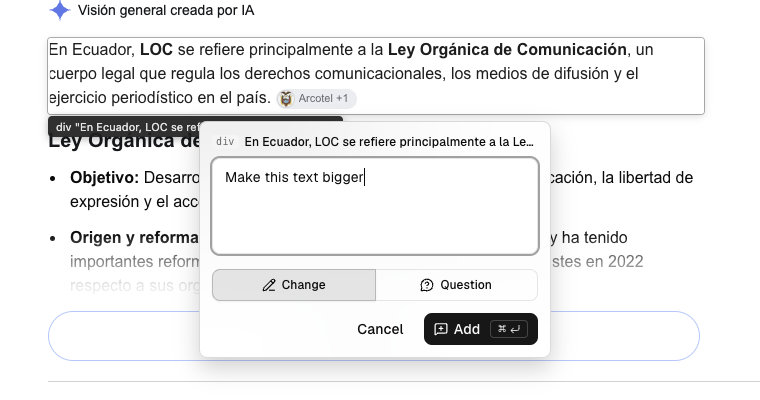

**After.**

- Clicking another element saves the open note and moves the card to the new element.
- While a note is open, page clicks are held by the picker, so links and buttons are not triggered.
- Clicking away saves a written note. Cancel and Escape still discard it.
- Enter adds the note; Shift+Enter starts a new line. ⌘↵ / Ctrl+Enter still work.

A note being written on the "Key Facts" heading:

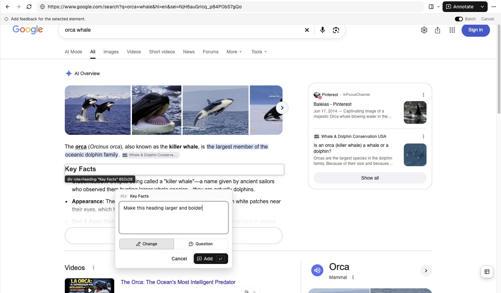

One click on the next element: note 1 is saved (marker 1 and the tray), and the card is on the
new element.

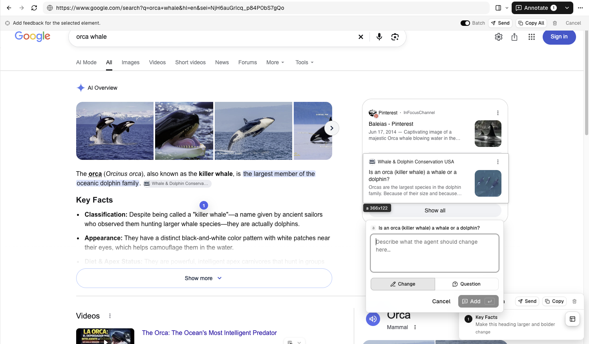

**How it was checked:** driven in the running app; existing tests for the element picker pass.

**Risk:** changes what Enter does in the note card, and holds page clicks while a card is open.
The picker's page-side script and its main-process controller are touched.

---

## 2. Send notes without the agent picker, and a Batch switch

**In short:** Send goes straight to the chat when it is obvious which one you mean.

**Before.** Send always opened a list of agents to choose from, and switched the sidebar to its
workspace view.

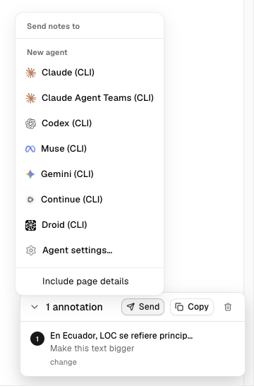

**After.**

- Send goes directly to the agent when exactly one agent tab is on screen, or failing that when
  the workspace has exactly one agent. In every other case the picker opens as before.
- A **Batch** switch sits in the annotate banner. On (default): notes collect in the tray until
  Send. Off: the card's button reads Send and each note is sent as it is written.

Three notes collected with Batch on:

Send pressed once with one chat in the workspace: no list, a "Notes sent." confirmation, and the
tray is empty.

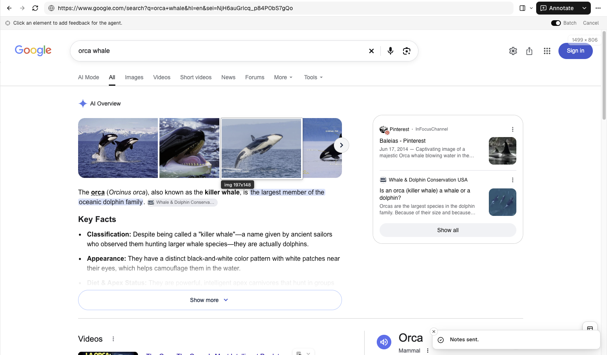

Batch off: the card sends on Enter.

**How it was checked:** driven in the running app with one agent, and with none (picker shown).
New unit tests cover the target choice and the send path.

**Risk:** a note could go to an agent the user did not expect when two agents exist but only one
is on screen. The Batch choice is stored per window profile, not in Settings.

---

## 3. Chat beside the page in one click

**In short:** one button puts the workspace's chat next to the browser, using the existing split.

**Before.** The same layout needed a tab dragged onto the edge of the pane.

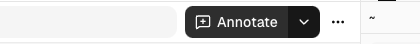

**After.** A button left of Annotate, with a small menu for the side.

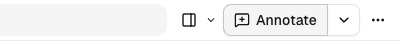

One click: page on the left, chat on the right. The notes sent in section 2 are visible in the
chat. A second click folds the chat back into the tabs.

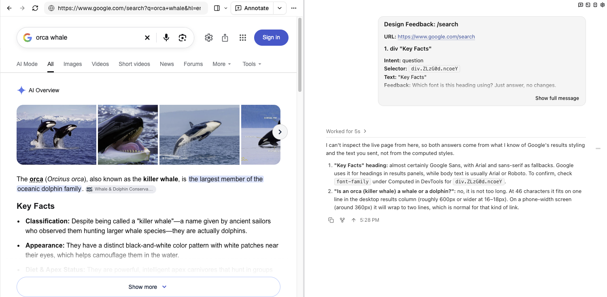

The menu chooses the side, and the choice is remembered.

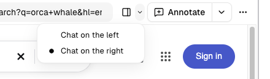

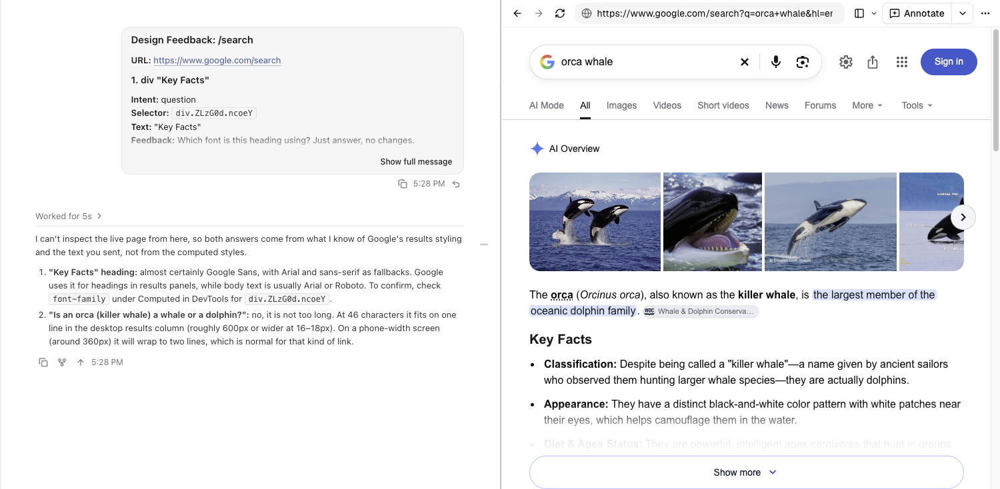

**How it was checked:** driven in the running app (show, hide, left, right). Unit tests cover
which chat is chosen.

**Risk:** adds a control to the browser toolbar. With several chats it picks the most recently
used one in that tab group.

---

## 4. Open a dev server in the browser when a terminal starts one

**In short:** run `npm run dev` and the page opens by itself.

**Before.** After the server started, its port had to be found in the ports list and clicked.

**After.** When a terminal in the active workspace prints a server URL and the port scan
confirms it is listening, the page opens in a browser tab.

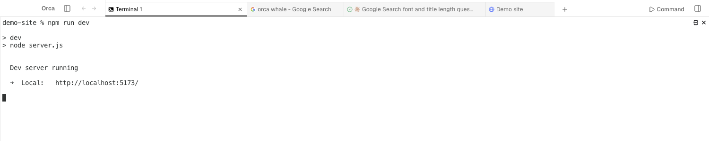

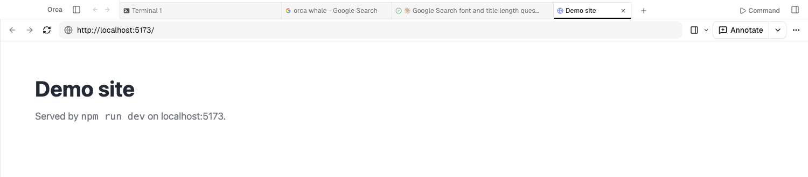

- Once per server. A server that stops and starts again opens again.
- No second tab if one is already on that address.
- Only for the active workspace, and only the first server a command starts.
- Settings > Browser > "Open dev servers automatically" turns it off.

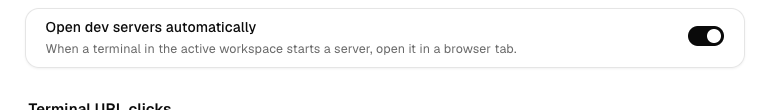

**How it was checked:** a real `npm run dev` in the running app. Unit tests cover the rules.

**Risk and known gaps:** on by default in this fork. Local workspaces only (not SSH or remote
runtimes). The setting is not yet in the settings search.

---

## 5. Thinner split divider

**In short:** the line between split panes is a hairline until you reach for it.

| Before (3px) | After (1px, 3px on hover or drag) |
|---|---|
| 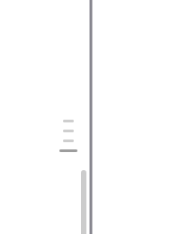 | 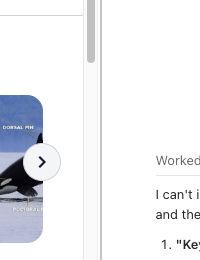 |

The 6px grab area is unchanged.

**Risk:** a visual change to every split in the app.

---

## Not yet done

- Upstream's four checks (`pnpm lint`, `pnpm typecheck`, `pnpm test`, `pnpm build`) have not all
  been run on these branches; typecheck and the affected test suites pass.
- Not tested on Windows or Linux.
- New interface strings are not yet in the translation catalogue.
- Branches are stacked on each other and need separating before any pull request.
